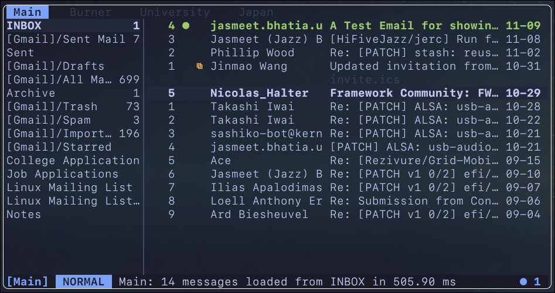

  
  <h1>Jerc</h1>
  
<strong>A keyboard-driven terminal email client, written in Rust, inspired by <a href="https://aerc-mail.org/">aerc</a>.
  </strong>

  

    <a href="#getting-started">Getting Started</a> ·
    <a href="docs/install.md">Install</a> ·
    <a href="docs/keybindings.md">Keybindings</a> ·
    <a href="docs/configuration.md">Configuration</a> ·
    <a href="CONTRIBUTING.md">Contributing</a>
  

---

## Features

| Features| Highlights |
| --- | --- |
| **Online and Offline Mail** | IMAP and Maildir accounts, multiple mailboxes, background refresh, and local-first cached reading. |
| **Attachment Previews** | Preview attachments like PDFs, images, and more! |
| **Keyboard First** | Vim motions and relative line numbers, smooth scrolling, searchable `?` help, and mouse support. |
| **Bulk Actions** | Visual selection, persistent marks, bulk actions, archive, spam handling, and in-mailbox filtering. |
| **Rich Reading** | HTML and plain-text views, tables, links, attachments, Git mailing list integrations, and optional inline images. |
| **Natural Composing** | Modal editing, reply options, recipient auto-suggestions, attachment picker, drafts, and send preview. |
| **Customization** | Multiple accounts, hot-swappable themes, adjustable panels, and rounded or square borders! |

See [configuration](docs/configuration.md) for the relevant controls.

## Getting Started

### Installation

Jerc is available for **[Linux](docs/install.md#linux), [macOS](docs/install.md#macos), [Windows](docs/install.md#windows)**, or **[Universal](docs/install.md#cargo-universal)**. We also offer multiple prebuilt binaries and package-manager options. See **[Installation Guide](docs/install.md)**.

### Essential Keys

| Key | Action |
| --- | --- |
| `j` / `k` | Move through messages |
| `J` / `K` | Change mailbox |
| `Alt n` / `Alt p` | Next/Previous Account |
| `Enter` | Open message |
| `/` | Search/filter |
| `Space` | Mark message
| `v` / `V` | Visual selection |
| `a` / `d` | Archive / confirm deletion |
| `c` / `r` / `f` | Compose / reply / forward |
| `?` | Search keybindings for current view |

The full reference lives in **[Keybindings](docs/keybindings.md)**. Press `?` inside Jerc for a searchable, context-aware shortcut palette.

## Documentation

- **[Keybindings](docs/keybindings.md)** — mail, reader, Compose, Contacts, attachments, and picker.
- **[Configuration](docs/configuration.md)** — accounts, privacy defaults, themes, layouts, and storage paths.
- **[OAuth & account discovery](docs/oauth.md)** — Google, Microsoft, and sign-in troubleshooting.
- **[Contacts](docs/contacts.md)** — contacts management and recipient autocomplete.
- **[Architecture](ARCHITECTURE.md)** — rendering, backend workers, state, and performance invariants.
- **[Contributing](CONTRIBUTING.md)** — development workflow and tests.

## Project Status

> [!WARNING]
> Jerc is under active development. IMAP and Maildir reading, SMTP sending, drafts, and the UI are implemented and somewhat finalized. IMAP IDLE synchronization is supported with polling fallback; full conversation threading and server-backed search are planned. Expect breaking changes before 1.0.

## License

Copyright (C) 2026 Jerc contributors.

Jerc's original source code is licensed under the [GNU General Public License,
version 3 only](LICENSE) (`GPL-3.0-only`). The bundled COSMIC notification
sound is separately licensed under [Creative Commons Attribution-ShareAlike
4.0](licenses/COSMIC-SOUND-LICENSE). Other third-party material retains its
respective license and notices.
